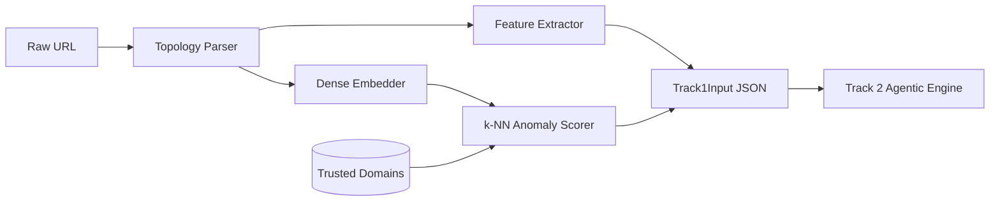

# Zero-Shot & Unsupervised Phishing URL Intelligence Pipeline

An explainable, multi-track cybersecurity intelligence pipeline combining high-dimensional vector embeddings, unsupervised anomaly detection, zero-shot Chain-of-Thought (CoT) reasoning, and prompt-injection defense mechanisms.

---

## 1. Project Overview & Team Structure

Modern phishing campaigns frequently bypass traditional supervised machine learning filters by deploying novel infrastructure, rapidly registering disposable apex domains, and generating ephemeral URLs. This project introduces an **unsupervised, zero-shot architecture** strictly decoupled into three technical tracks:

| Track | Domain | Focus Area | Core Responsibilities |
| :--- | :--- | :--- | :--- |
| **Track 1** *(Current)* | **ML / Vector Lead** | **Vector Space Anomaly Detection** | • URL topology parsing & lexical feature extraction<br>• High-dimensional embeddings (`all-MiniLM-L6-v2`)<br>• Trusted reference domain indexing (Tranco)<br>• k-NN Out-of-Distribution (OOD) anomaly scoring |
| **Track 2** | **AI / Backend Lead** | **Agentic Threat Engine** | • Zero-shot semantic analysis via LLM reasoning<br>• Brand impersonation & typosquatting detection<br>• Structured Pydantic JSON contracts (`Track1Input` -> `AgenticThreatAnalysis`) |
| **Track 3** | **SecOps / QA Lead** | **Adversarial Guardrails & LLMOps** | • Indirect prompt injection defense (OWASP LLM Top 10)<br>• URL payload sanitization & decoding interceptors<br>• Benchmark curation (60-sample) & evaluation dashboard |

---

## 2. Track 1: Vector Space Anomaly Detection

### 2.1 How It Works
Rather than learning the infinite permutations of malicious URLs, Track 1 models **what benign, trusted infrastructure looks like**:
1. **URL Topology Parsing**: Deconstructs raw URLs into apex domain, subdomains, scheme, path, query parameters, and port.
2. **Lexical & Structural Feature Extraction**: Calculates Shannon character entropy, subdomain depth, path depth, hyphen counts, digit frequencies, and raw IP host flags.
3. **Dense Vector Embeddings**: Projects topological token representations into 384-dimensional continuous vector space using open-source transformer models with offline deterministic fallback resilience.
4. **Trusted Reference Store**: Indexes high-reputation root domains (curated from Tranco / Cisco Umbrella).
5. **k-NN Cosine Anomaly Scoring**: Computes the mean cosine distance to the $k=5$ nearest trusted reference vectors. URLs exhibiting significant structural or semantic deviation from legitimate infrastructure receive high anomaly scores and trigger Track 2 agentic threat inspection.



---

## 3. Quickstart & Installation Guide

### Prerequisites
- Python 3.10+ (Tested on Python 3.12 on Windows)
- Git

### 1. Clone & Setup Virtual Environment
```powershell
# Clone repository
git clone https://github.com/anujarora344/zero-shot-phishing-pipeline.git
cd zero-shot-phishing-pipeline

# Create virtual environment
python -m venv .venv

# Activate virtual environment (Windows PowerShell)
.\.venv\Scripts\Activate.ps1
# Or on Linux / macOS:
# source .venv/bin/activate
```

### 2. Install Dependencies
```powershell
# Upgrade pip and install core Track 1 packages
pip install --upgrade pip
pip install numpy scikit-learn pydantic pytest fastapi httpx
```

---

## 4. Running Track 1

### A. Run End-to-End Demonstration
To execute the comprehensive validation script across trusted, spoofed, and obfuscated URLs:
```powershell
python examples/run_track_1_demo.py
```

### B. Analyze a Single URL via CLI
```powershell
python -m track_1_vector.anomaly_engine --url "http://paypal-login.security-verify.com/auth"
```
*Output:*
```json
{
  "raw_url": "http://paypal-login.security-verify.com/auth",
  "domain": "security-verify.com",
  "subdomains": ["paypal-login"],
  "features": {
    "entropy": 4.3282,
    "subdomain_depth": 1,
    "has_ip_host": false,
    "path_length": 5,
    "url_length": 44,
    "domain_length": 19,
    "special_char_count": 8,
    "digit_count": 0,
    "hyphen_count": 2,
    "subdomain_length": 12,
    "path_depth": 1,
    "query_param_count": 0,
    "is_https": false,
    "is_punycode": false
  },
  "knn_distance": 0.5112,
  "anomaly_score": 0.5112,
  "is_anomaly": true
}
```

### C. Analyze a Batch of URLs
```powershell
python -m track_1_vector.anomaly_engine --batch "https://accounts.google.com" "http://appleid-verify.com" "https://github.com/login"
```

---

## 5. Running Automated Tests

Run the full pytest suite for Track 1:
```powershell
python -m pytest tests/test_track_1.py -v
```
All 17 automated unit and integration tests validate:
- URL topology decomposition across edge cases (IP hosts, ports, multi-subdomains, missing schemes).
- Numerical feature validity and Shannon entropy computations.
- Embedding vector shapes (384-dim), unit L2 normalization, and deterministic reproducibility.
- Reference store fallback resilience.
- k-NN cosine distance scoring and decision boundaries.
- **Strict Pydantic schema validation** matching Track 2's `Track1Input` contract.

---

## 6. Repository Architecture

```
.
├── data/
│   └── trusted_reference_domains.csv   # Curated Tranco top benchmark domains
├── docs/
│   ├── COMMON_DECISIONS.md             # Cross-track schema contracts & roadmap
│   └── TRACK_1_PLAN.md                 # Track 1 architectural specification
├── examples/
│   └── run_track_1_demo.py             # Live validation demo with Pydantic verification
├── schemas/
│   ├── track1_output.json              # Standardized Track 1 output JSON schema
│   ├── track2_output.json              # Standardized Track 2 output JSON schema
│   └── track3_output.json              # Standardized Track 3 output JSON schema
├── tests/
│   ├── test_api.py                     # API endpoint tests
│   └── test_track_1.py                 # Comprehensive Track 1 test suite (17 tests)
├── track_1_vector/                     # MY TRACK: Vector Space Anomaly Detection
│   ├── __init__.py                     # Package export
│   ├── anomaly_engine.py               # Master pipeline orchestrator & CLI
│   ├── anomaly_scorer.py               # k-NN Cosine distance anomaly scorer
│   ├── embedding_model.py              # Dense vector embedder (MiniLM + fallback)
│   ├── feature_extractor.py            # Structural & lexical numerical features
│   ├── reference_store.py              # Reference domain index loader & vector cache
│   └── url_parser.py                   # URL topology & Shannon entropy parser
├── track_2_agentic/                    # Track 2: Agentic Threat Engine
│   ├── reasoning_engine.py             # Groq/LLM Chain-of-Thought reasoning
│   └── schemas.py                      # Pydantic data interchange models
├── track_3_secops/                     # Track 3: Guardrails & LLMOps
│   └── guardrail_engine.py             # Indirect injection defense stub
├── api.py                              # FastAPI unified endpoint
├── main.py                             # Multi-track mock execution script
├── pytest.ini                          # Test configuration & pythonpath
└── requirements.txt                    # Project dependency manifest
```

---

## 7. Cross-Track Integration Contract

Track 1 outputs a dictionary guaranteed to parse into Track 2's Pydantic model:
```python
from track_1_vector.anomaly_engine import analyze_url
from track_2_agentic.schemas import Track1Input

# 1. Generate Track 1 output
track_1_data = analyze_url("http://paypal-login.security-verify.com/auth")

# 2. Track 2 consumes it with 100% type safety
validated_payload = Track1Input(**track_1_data)
```
