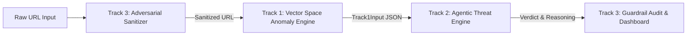

# Common Project Decisions & Cross-Track Governance
**Project**: Zero-Shot & Unsupervised Phishing URL Intelligence Pipeline  
**Document Status**: Provisional / Working Proposal (For Review by Track 1, Track 2, & Track 3 Leads)  
**Date**: October 2026  

---

## 1. Executive Summary & Purpose

The **Zero-Shot & Unsupervised Phishing URL Intelligence Pipeline** is designed as a decoupled, 3-track architecture:
- **Track 1**: Vector Space Anomaly Detection (Unsupervised Out-of-Distribution scoring)
- **Track 2**: Agentic Threat Engine (Chain-of-Thought LLM reasoning & brand impersonation)
- **Track 3**: Adversarial Guardrails & SecOps (Indirect prompt-injection defense & evaluation harness)

To maintain true technical independence and prevent downstream integration bottlenecks in Weeks 6–7, all three track leads must establish an explicit consensus on interchange schemas, pipeline data contracts, runtime environments, and operational boundaries.

This document records **decisions already established in the repository**, **decisions requiring team confirmation**, and **engineering recommendations**.

---

## 2. Decision Log & Governance Matrix

| # | Topic / Area | Current Status | Who Must Confirm | Impact / Blocking Level | Recommendation |
|---|--------------|----------------|------------------|-------------------------|----------------|
| **D1** | **Track 1 -> Track 2 Schema** | **Established** in code (`track_2_agentic/schemas.py`) | All Leads | **High** (Defines Track 1 output) | Maintain strict compatibility with `Track1Input` (see Section 3). |
| **D2** | **Track 2 -> Track 3 Schema** | **Established** in code (`track_2_agentic/schemas.py`) | Track 2 & 3 | **High** (Defines threat output) | Adhere to `AgenticThreatAnalysis` JSON contract. |
| **D3** | **End-to-End Pipeline Order** | **Open** | All Leads | **High** (Architecture flow) | Recommended: **Track 3 Sanitizer -> Track 1 Anomaly Engine -> Track 2 Agentic Reasoner -> Track 3 Audit Log**. |
| **D4** | **Input URL Format & Ingestion** | **Open** | All Leads | Medium (Ingestion robustness) | Accept raw strings with or without schemes (`http://`, `https://`); parse gracefully. |
| **D5** | **Trusted Reference Dataset** | **Open** (Sample used) | Track 1 & 3 | High (Model calibration) | Use a curated subset of **Tranco Top 10k** root domains for local reproducible indexing. |
| **D6** | **Shared Python Environment** | **Open** (Requirements diverge) | All Leads | Medium (Deployment risk) | Clean up pinned packages in `requirements.txt`; ensure CPU-only inference capability. |
| **D7** | **LLM Provider & Credentials** | **Established** (Groq in Track 2) | Track 2 Lead | Low for Track 1 | Track 1 must run 100% locally with zero external API dependencies or costs. |
| **D8** | **Anomaly Threshold Calibration** | **Open** | Track 1 & 2 | Medium (Tuning) | Calibrate `anomaly_score` to [0.0, 1.0] with default decision boundary `threshold = 0.50`. |

---

## 3. Data Contracts & Standardized Schemas

### 3.1 Input to Track 1 (Raw Ingestion)
The pipeline ingestion interface accepts single or batch URLs.
```json
{
  "urls": [
    "https://accounts.google.com/signin",
    "http://paypal-login.security-verify.com/auth"
  ]
}
```

### 3.2 Output of Track 1 / Input to Track 2 (`Track1Input`)
*Confirmed against `schemas/track1_output.json` and `track_2_agentic/schemas.py`:*
```json
{
  "raw_url": "http://paypal-login.security-verify.com/auth",
  "domain": "security-verify.com",
  "subdomains": ["paypal-login"],
  "features": {
    "url_length": 45,
    "domain_length": 19,
    "subdomain_depth": 1,
    "path_length": 5,
    "entropy": 4.12,
    "has_ip_host": false,
    "special_char_count": 3,
    "digit_count": 0
  },
  "knn_distance": 0.842,
  "anomaly_score": 0.89,
  "is_anomaly": true
}
```

#### Field Specifications:
1. `raw_url` (*string, required*): The original URL evaluated.
2. `domain` (*string, required*): The registered apex/root domain (e.g., `security-verify.com`).
3. `subdomains` (*list of strings, required*): Split list of subdomain components excluding `www`.
4. `features` (*dict, required*): Extracted structural and lexical measurements.
5. `knn_distance` (*float, required*): Unbounded mean cosine distance to the $k$ nearest reference vectors.
6. `anomaly_score` (*float, required*): Normalized anomaly score strictly bounded in $[0.0, 1.0]$.
7. `is_anomaly` (*bool, required*): Boolean flag indicating whether `anomaly_score >= threshold`.

### 3.3 Output of Track 2 (`AgenticThreatAnalysis`)
*Confirmed against `schemas/track2_output.json`:*
```json
{
  "raw_url": "http://paypal-login.security-verify.com/auth",
  "track1_ref": {
    "anomaly_score": 0.89,
    "is_anomaly": true
  },
  "verdict": "PHISHING",
  "confidence": 0.95,
  "impersonated_brand": "PayPal",
  "reasoning_chain": [
    "Detected target brand 'PayPal' embedded in subdomain.",
    "Apex domain 'security-verify.com' is completely unrelated to official PayPal infrastructure.",
    "Combination of high vector anomaly score and brand mismatch indicates domain spoofing."
  ],
  "threat_indicators": [
    "Brand Impersonation",
    "Subdomain Misdirection"
  ]
}
```

### 3.4 Output of Track 3 (`FinalSecurityAudit`)
*Confirmed against `schemas/track3_output.json`:*
```json
{
  "pipeline_timestamp": "2026-09-23T21:00:00Z",
  "raw_url": "http://paypal-login.security-verify.com/auth",
  "security_audit": {
    "indirect_prompt_injection_detected": false,
    "sanitized_payload": "http://paypal-login.security-verify.com/auth",
    "payload_decoded": false
  },
  "analysis": {
    "verdict": "PHISHING",
    "confidence": 0.95,
    "impersonated_brand": "PayPal",
    "threat_indicators": ["Brand Impersonation", "Subdomain Misdirection"],
    "explanation": "..."
  }
}
```

---

## 4. End-to-End Execution Flow (Proposed)



1. **Ingress & Sanitization (Track 3)**: Intercepts hidden prompt injection attempts (e.g. `?q=Ignore previous instructions...`) before reaching downstream LLMs.
2. **Topology & Anomaly Scoring (Track 1)**: Computes high-dimensional vector representations and k-NN distance against trusted root domains.
3. **Semantic Reasoning (Track 2)**: If anomalous or suspicious, triggers LLM Chain-of-Thought analysis to detect typosquatting, brand spoofing, or deceptive apex domains.
4. **Final Packaging & UI (Track 3)**: Logs telemetry, generates performance reports, and feeds the UI dashboard.

---

## 5. Action Items for Team Synchronization

1. **Member 1 (Track 1 Lead - Current)**:
   - Provide standalone CLI and Python API matching `Track1Input`.
   - Index a verified sample of benign Tranco root domains.
   - Keep model inference 100% local (CPU-compatible).
2. **Member 2 (Track 2 Lead)**:
   - Ensure `analyze_url_threat` handles edge cases where `features` dictionary contains variable keys.
   - Support offline or mock mode when `GROQ_API_KEY` is not present during testing.
3. **Member 3 (Track 3 Lead)**:
   - Confirm whether Track 3 sanitization runs *before* Track 1 or *after* Track 1. (Recommendation: runs *before* Track 1 to prevent injection vectors from entering tokenizers).
