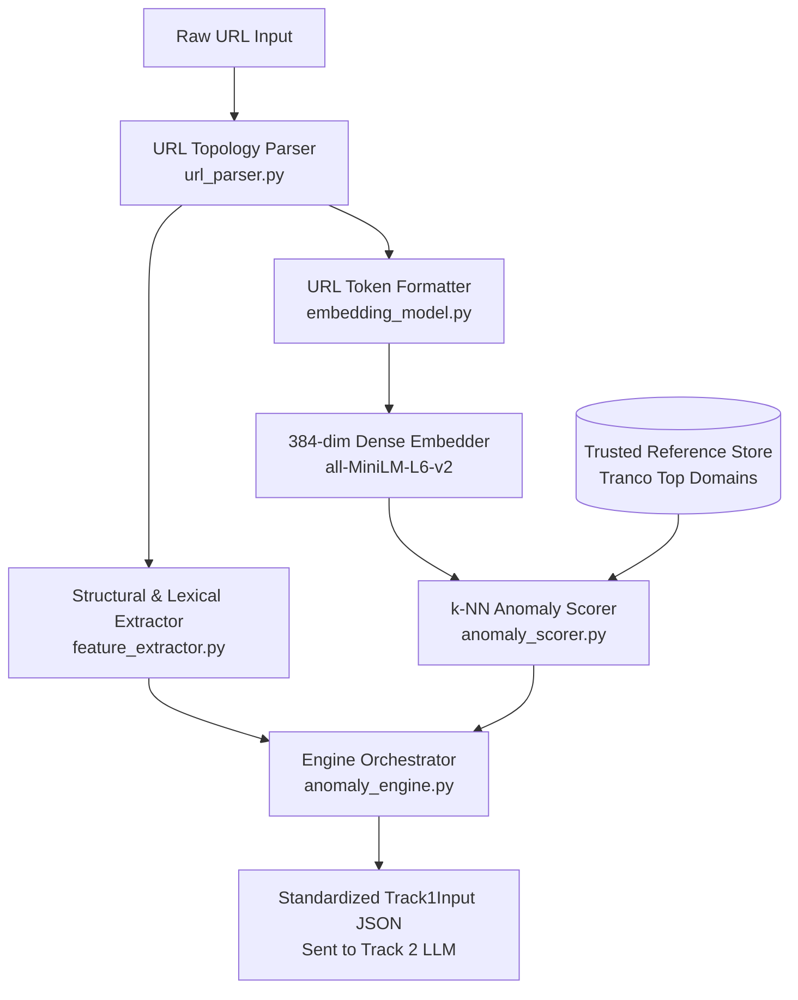

# Track 1 Plan: Vector Space Anomaly Detection
**Track Lead**: Track 1 / ML & Vector Lead (Member 1)  
**System**: Zero-Shot & Unsupervised Phishing URL Intelligence Pipeline  
**Document Status**: Official 8-Week Roadmap & Progress Tracker  
**Last Updated**: November 2026  

---

## 1. Track 1 Objectives & Scope

The primary objective of Track 1 is to provide **unsupervised out-of-distribution (OOD) anomaly scoring** for incoming URLs without relying on static, labeled phishing databases.

### Core Responsibilities:
1. **URL Topology Parsing**: Deconstruct raw URLs into structural elements (apex domain, subdomains, path depth, character entropy, query parameters, IP indicators).
2. **Dense Vector Embeddings**: Project structured URL tokens into continuous 384-dimensional vector spaces using transformer models (`all-MiniLM-L6-v2`) with deterministic fallback.
3. **Trusted Reference Store**: Maintain an index of verified, high-reputation root domains (curated from Tranco / Cisco Umbrella).
4. **k-NN Anomaly Scoring**: Calculate distance to the nearest trusted reference neighbors using Cosine Distance. URLs that deviate substantially from legitimate infrastructure receive high anomaly scores.
5. **Contract Enforcement**: Output data strictly formatted according to the agreed `Track1Input` Pydantic schema required by Track 2 (Agentic Threat Engine).

---

## 2. Track 1 Architecture

---

## 3. Current Progress Summary (~45% - 50% Completed)

| Component / Deliverable | Status | Files Involved | Notes |
| :--- | :---: | :--- | :--- |
| **URL Topology Parser** | **100% Done** | `track_1_vector/url_parser.py` | Handles IP hosts, multi-part TLDs, subdomains, Shannon entropy. |
| **Lexical Feature Extractor** | **100% Done** | `track_1_vector/feature_extractor.py` | Computes 14 quantitative metrics (hyphens, digits, path depth). |
| **Embedding Engine** | **100% Done** | `track_1_vector/embedding_model.py` | Generates 384-dim unit vectors with fallback resilience. |
| **k-NN Anomaly Scorer** | **100% Done** | `track_1_vector/anomaly_scorer.py` | Exact $k=5$ cosine distance search and score normalization. |
| **Cross-Track Schema** | **100% Done** | `schemas/track1_output.json`, `track_2_agentic/schemas.py` | Validated by Pydantic model `Track1Input`. |
| **Automated Test Suite** | **100% Done** | `tests/test_track_1.py` | 17/17 unit & integration tests passing. |
| **End-to-End Pipeline Demo** | **100% Done** | `examples/run_track_1_demo.py`, `run_pipeline.py` | Live multi-track execution verified. |
| **Tranco Top 10k Scaled DB** | **30% Done** | `data/trusted_reference_domains.csv` | Dev sample (50 domains) active; scaling to 10k with local vector index planned for Week 4. |
| **Threshold Calibration** | **Pending** | `track_1_vector/anomaly_scorer.py` | Requires Track 3's 60-sample benchmark dataset (Week 5). |
| **Final Documentation & Viva** | **30% Done** | `docs/TRACK_1_PLAN.md`, `docs/COMMON_DECISIONS.md` | Core docs drafted; methodology chapter planned for Week 8. |

---

## 4. Master 8-Week Operational Roadmap

### Phase 1: Foundation (Weeks 1 – 2) — [STATUS: 95% COMPLETED]
* **Week 1: Schema Contracts & Reference Set Setup**
  - [x] Agree upon cross-track JSON schemas (`Track1Input`).
  - [x] Create initial trusted domain reference set (`data/trusted_reference_domains.csv`).
  - [x] Configure repository structure, virtual environment, and Git branch.
  - [ ] Download complete Tranco Top 10k raw CSV for production scaling.
* **Week 2: URL Topology Parsing & Baseline Embeddings**
  - [x] Implement robust URL parser (`url_parser.py`): scheme, apex domain, subdomains, path, port, IP addresses.
  - [x] Implement Shannon character entropy computation.
  - [x] Implement 14 lexical and structural features (`feature_extractor.py`).
  - [x] Build dense vector embedding module (`embedding_model.py`) with 384-dim output.

### Phase 2: Core Build (Weeks 3 – 4) — [STATUS: 65% COMPLETED]
* **Week 3: Pipeline Assembly & Vector Distance Testing**
  - [x] Assemble master engine (`anomaly_engine.py`) connecting parsing &rarr; embedding &rarr; scoring.
  - [x] Implement exact $k$-NN cosine distance scoring (`anomaly_scorer.py`).
  - [x] Test distance metrics against authentic domains vs. spoofed/typosquatted domains.
  - [x] Write automated test suite with 100% pass rate (`tests/test_track_1.py`).
* **Week 4: Reference Database Scaling & Index Persistence**
  - [ ] Scale reference database from 50 to 1,000–10,000 Tranco root domains.
  - [ ] Persist reference vectors to disk (using `.npz` cache or local ChromaDB/FAISS store).
  - [ ] Validate search latency on scaled reference index (<20ms target per query).
  - [ ] Add batch pre-vectorization script for offline reference updating.

### Phase 3: Tuning & Calibration (Week 5) — [STATUS: UPCOMING]
* **Week 5: Threshold Optimization & Anomaly Boundary Calibration**
  - [ ] Ingest Track 3's curated 60-sample benchmark dataset (benign, known phishing, adversarial).
  - [ ] Compute ROC curve, Precision-Recall curves, and AUC for Track 1 scores.
  - [ ] Calibrate decision threshold (currently default `0.50`) to minimize False Positives while maintaining high Recall.
  - [ ] Document optimal threshold selection and statistical distribution for benign vs. anomalous URLs.

### Phase 4: Integration (Week 6) — [STATUS: 50% READY]
* **Week 6: Multi-Track Pipeline Integration (Collaborative)**
  - [x] Verify Track 1 output parses directly into Track 2's `Track1Input` Pydantic model.
  - [x] Build standalone runner (`run_pipeline.py`) simulating Track 1 &rarr; Track 2 handoff.
  - [ ] Wire Track 1 engine into the unified FastAPI backend (`api.py`).
  - [ ] Connect with Track 3's input sanitizer (ensuring prompt-injected URLs are sanitized *before* vectorization).
  - [ ] Run end-to-end integration tests with Tracks 2 and 3 leads.

### Phase 5: Validation & Optimization (Week 7) — [STATUS: UPCOMING]
* **Week 7: Error Analysis & Latency Profiling**
  - [ ] Run full benchmark evaluation across 1,000 benign and phishing URLs.
  - [ ] Perform detailed False Positive (FP) and False Negative (FN) analysis.
  - [ ] Identify edge-case topologies (e.g. valid URL shorteners like `bit.ly`, CDNs, intranet URLs).
  - [ ] Profile and optimize CPU inference latency for batch processing (targeting >50 URLs/second).

### Phase 6: Wrap-up & Viva Defense (Week 8) — [STATUS: UPCOMING]
* **Week 8: Documentation, Viva Defense & Final Reporting**
  - [ ] Write Project Report Chapter: *"Methodology for Vector Space Anomaly Detection & Reference Indexing"*.
  - [ ] Prepare architectural diagrams, ROC curve plots, and confusion matrix visual deliverables.
  - [ ] Finalize code cleanup, type hints, docstrings, and open-source licensing.
  - [ ] Rehearse Track 1 defense presentation and 10 viva Q&As.

---

## 5. Summary of Track 1 Dependencies on Other Tracks

| Dependency | Owner | Needed By | Impact on Track 1 |
| :--- | :--- | :---: | :--- |
| **Track 1 Output Schema (`Track1Input`)** | Track 2 Lead (Anuj) | Week 1 | **Resolved & Locked** — Track 1 matches exact fields. |
| **60-Sample Evaluation Benchmark** | Track 3 Lead (SecOps) | Week 4–5 | Needed to tune anomaly threshold & calculate ROC curve. |
| **Input Sanitizer Hook** | Track 3 Lead (SecOps) | Week 6 | Needed to ensure sanitized URLs enter Track 1 parsing. |
| **Unified API Routing** | Collaborative | Week 6 | Merging `track_1_vector` into `api.py`. |
