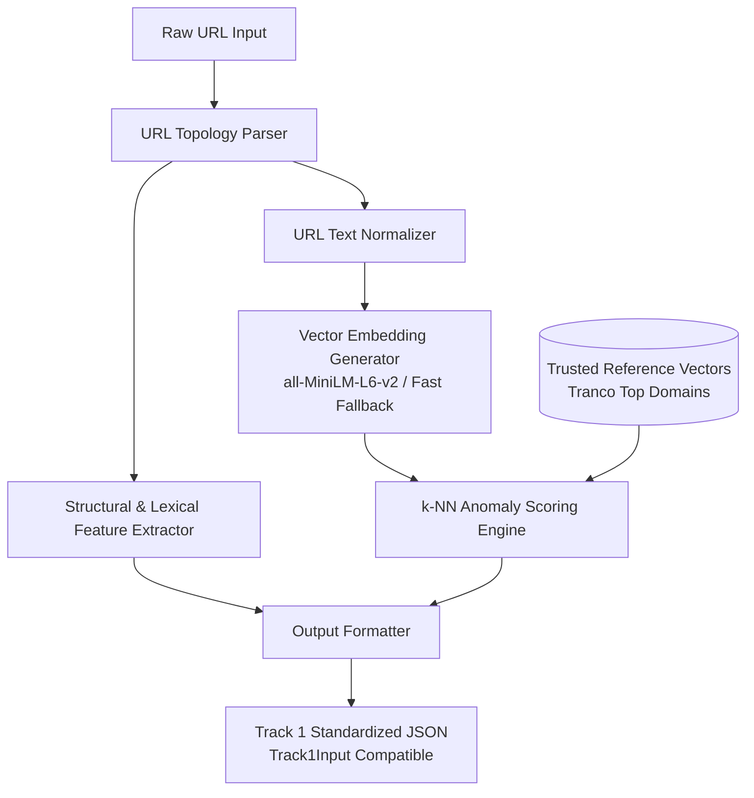

# Track 1 Plan: Vector Space Anomaly Detection
**Track Lead**: Track 1 / ML & Vector Lead (Member 1)  
**System**: Zero-Shot & Unsupervised Phishing URL Intelligence Pipeline  
**Document Status**: Baseline Specification & Architectural Guide  
**Date**: October 2026  

---

## 1. Track 1 Objectives

The primary objective of Track 1 is to provide **unsupervised out-of-distribution (OOD) anomaly scoring** for incoming URLs without relying on static, labeled phishing databases.

### Key Goals:
1. **Structural & Lexical Parsing**: Deconstruct raw URLs into topological elements (apex domain, subdomains, path depth, character entropy, token ratios, IP indicators).
2. **Dense Vector Embeddings**: Project raw URL strings and domain representations into continuous high-dimensional vector spaces using transformer models (e.g., `sentence-transformers/all-MiniLM-L6-v2`) and robust fallback mechanisms.
3. **Trusted Reference Store**: Maintain a reference index of verified, high-reputation domains (e.g., top ranked domains from Tranco / Cisco Umbrella).
4. **k-NN Anomaly Scoring**: Calculate distance in embedding space to the nearest reference neighbors using cosine distance. URLs that deviate substantially from legitimate topological and semantic structures receive high anomaly scores.
5. **Contract Enforcement**: Output data formatted strictly according to the agreed `Track1Input` schema required by Track 2's Agentic Reasoning Engine.

---

## 2. Track 1 Architecture



### Modular Directory Structure:
```
track_1_vector/
├── __init__.py               # Package export & versioning
├── url_parser.py             # URL decomposition, domain & subdomain extraction
├── feature_extractor.py      # Numerical lexical & structural feature extraction
├── embedding_model.py        # Dense vector embedding pipeline (MiniLM + fallback)
├── reference_store.py        # Trusted reference domain loader & vector store
├── anomaly_scorer.py         # k-NN distance & score normalization
└── anomaly_engine.py         # High-level pipeline controller & interface
```

---

## 3. Technical Choices & Rationales

### 3.1 Why Unsupervised / Anomaly-Based over Supervised Classification?
- **Zero-Day Evasion**: Attackers register new domains daily, spin up novel TLD combinations, and rapidly abandon flagged URLs. Supervised classifiers trained on static datasets suffer from distribution shifts and catastrophic forgetting.
- **Unsupervised Reference Baseline**: Rather than trying to learn every possible way a URL can be malicious (an infinite, moving target), Track 1 models what **benign, trusted infrastructure looks like**. Deviations from this manifold indicate an anomaly worthy of agentic inspection.
- **Zero-Shot Synergy**: Track 1 acts as a mathematical filter; when a URL is anomalous, Track 2 (Agentic LLM) receives structured evidence to determine *why* (brand impersonation, homoglyphs, typosquatting).

### 3.2 Embedding Model Selection (`all-MiniLM-L6-v2`)
- **Dimensionality**: 384 dimensions.
- **Inference Speed**: Highly optimized for CPU inference (<15ms per sample on modern desktop CPUs).
- **Semantic Capture**: Captures contextual n-grams, brand tokens, and structural similarities across domain words (e.g., recognizing that `paypal-login-verify` is semantically distinct from standard banking domains).
- **Graceful Fallback**: To ensure zero crashes during offline evaluation or network timeouts, an adaptive character/subword n-gram vectorizer is bundled as a fallback.

### 3.3 Vector Indexing & Distance Metric
- **Metric**: Cosine Distance ($1 - \text{cosine similarity}$). Cosine distance measures directional orientation in dense space, independent of vector magnitude.
- **k-NN Strategy**: Compute the average distance to the $k=5$ nearest trusted reference vectors:
  $$\text{anomaly\_score} = \frac{1}{k} \sum_{i=1}^{k} \text{CosineDistance}(v_{\text{query}}, v_{\text{ref}, i})$$
- **Index Implementation**: For the baseline, exact $k$-NN via `scikit-learn` `NearestNeighbors` provides deterministic results with zero heavyweight database overhead. For production scale (1M+ domains), FAISS / ChromaDB can be plugged in seamlessly behind the `ReferenceStore` interface.

---

## 4. Current Baseline Implementation & Scope

- **Implemented**:
  - Full URL decomposition: domain, subdomains, path, query, protocol, port.
  - Lexical features: Shannon entropy, digit ratio, hyphen count, special character count, IP-address hostname detection.
  - Embedding pipeline: `all-MiniLM-L6-v2` with transformer encoding and fallback resilience.
  - Curated reference set of verified root domains.
  - Exact k-NN cosine distance scoring and normalization.
  - Strict compliance with `schemas/track1_output.json` and `track_2_agentic/schemas.py:Track1Input`.

---

## 5. Limitations & Future Upgrades

1. **Unusual != Phishing**: An anomalous URL is not inherently malicious. A newly registered corporate intranet or legitimate rare domain may have a high anomaly score. Track 1 is designed to work *with* Track 2's reasoning engine, not as a solitary binary decider.
2. **Reference Set Granularity**: The dev baseline uses a curated sample of top domains. Moving to the complete Tranco 100k will require persistent pre-computed vector index caching.
3. **IDN Homoglyphs**: Lexical parsing flags non-ASCII / punycode domains; full homoglyph confusable matching is shared between Track 1 feature flags and Track 2 LLM analysis.

---

## 6. Next Steps for Member 1
- [x] Establish modular Python structure inside `track_1_vector/`.
- [x] Implement URL parsing and feature extraction.
- [x] Implement vector embedding and k-NN scoring.
- [x] Validate cross-track schema compliance (`Track1Input`).
- [ ] Benchmark latency on batch inputs (100 URLs).
- [ ] Calibrate decision threshold against Track 3's 60-sample benchmark dataset once assembled.
